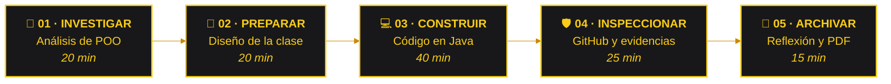
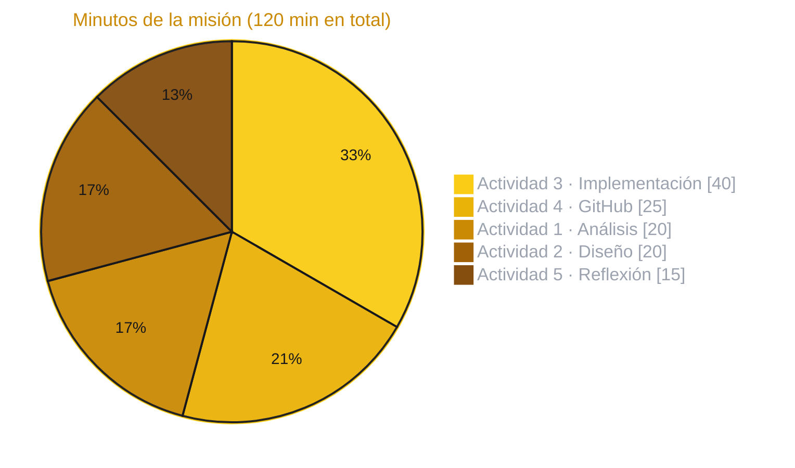
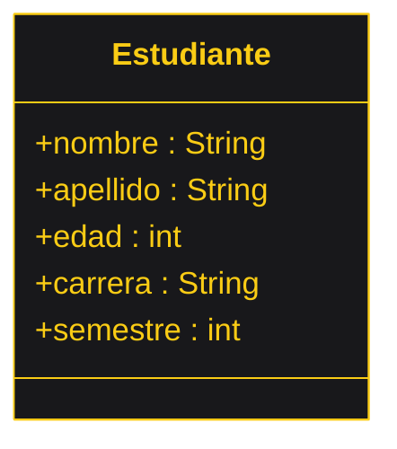
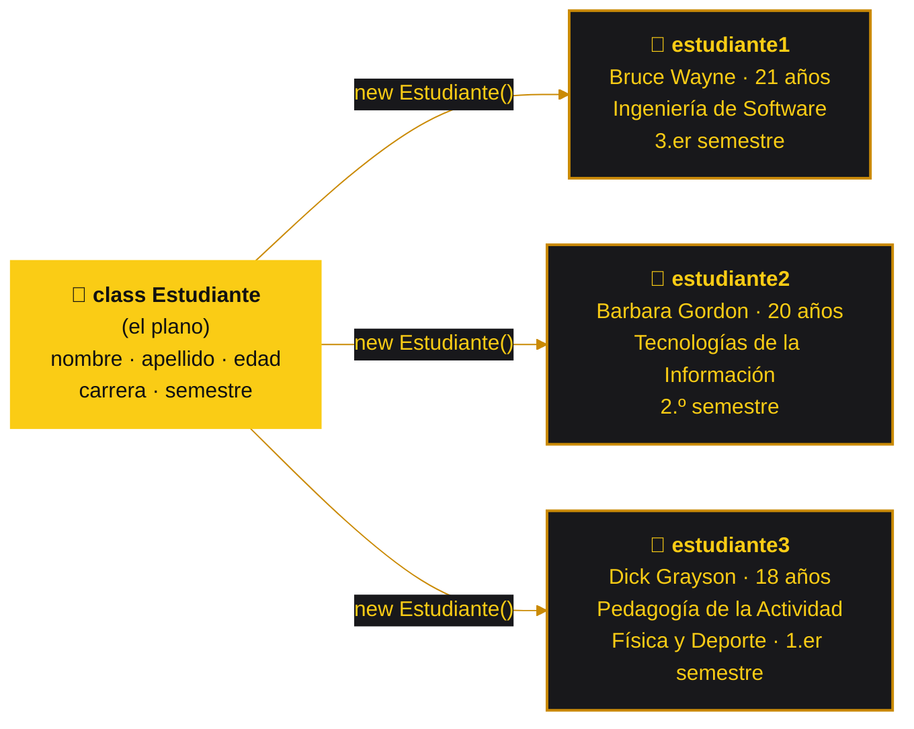
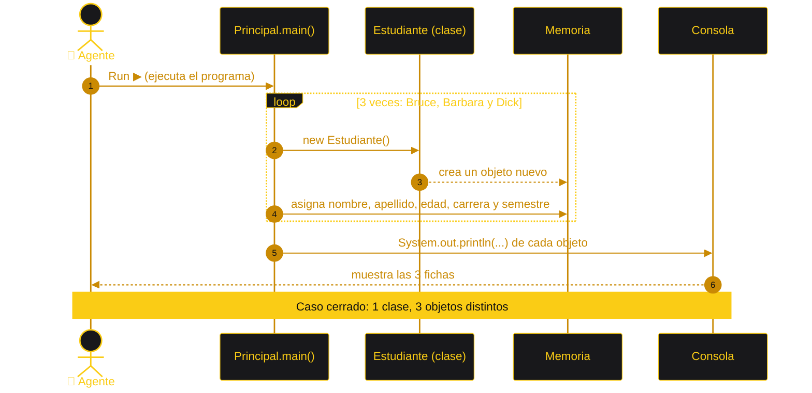

<a name="inicio"></a>

<h1 align="center">POO-Tema1-Grupo1</h1>

<p align="center">
  <strong>🦇 LA BATICUEVA DEL CÓDIGO · GOTHAM OBJECT DIVISION</strong><br>
  <em>Gotham tiene villanos. Nosotros tenemos clases y objetos.</em>
</p>

<div align="center">


<h2>🦇 LA CLASE QUE GOTHAM NECESITA</h2>

<picture>
  <source media="(prefers-color-scheme: dark)" srcset="https://readme-typing-svg.demolab.com?font=Cinzel&amp;weight=700&amp;size=25&amp;duration=3000&amp;pause=1400&amp;color=FACC15&amp;center=true&amp;vCenter=true&amp;width=880&amp;height=64&amp;lines=Si+lo+puedes+imaginar%2C+lo+puedes+instanciar.;Una+clase+es+el+plano.+Cada+objeto%2C+un+h%C3%A9roe+distinto.;De+d%C3%ADa+estudiantes.+De+noche%2C+cazadores+de+bugs.;Cinco+mentes.+Una+clase.+Tres+objetos.;En+Gotham+no+hay+variables+sueltas%3A+hay+objetos.;Gotham+duerme.+La+Baticomputadora+compila.">
  <source media="(prefers-color-scheme: light)" srcset="https://readme-typing-svg.demolab.com?font=Cinzel&amp;weight=700&amp;size=25&amp;duration=3000&amp;pause=1400&amp;color=A16207&amp;center=true&amp;vCenter=true&amp;width=880&amp;height=64&amp;lines=Si+lo+puedes+imaginar%2C+lo+puedes+instanciar.;Una+clase+es+el+plano.+Cada+objeto%2C+un+h%C3%A9roe+distinto.;De+d%C3%ADa+estudiantes.+De+noche%2C+cazadores+de+bugs.;Cinco+mentes.+Una+clase.+Tres+objetos.;En+Gotham+no+hay+variables+sueltas%3A+hay+objetos.;Gotham+duerme.+La+Baticomputadora+compila.">
  
</picture>

**La noche es oscura. El código tiene que ser claro.**


<br>


<br><br>

**Bienvenidos a la Baticueva, nuestra base de operaciones en Java.**<br>
Aquí dibujamos el plano de un estudiante, lo convertimos en código<br>
y creamos tres objetos que cobran vida en la consola.

**Cinco mentes. Una clase. Tres objetos.**

[🌃 Expediente](#-el-expediente--objetivo-de-la-misión) ·
[🦇 Batfamilia](#-la-batfamilia--integrantes-y-roles) ·
[🔎 Protocolo](#-protocolo-de-la-baticueva--las-5-actividades) ·
[🧠 Actividad 1](#-actividad-1--análisis-y-conceptualización) ·
[📐 Actividad 2](#-actividad-2--diseño-de-la-clase-estudiante) ·
[💻 Actividad 3](#-actividad-3--implementación-en-java) ·
[🚀 Ejecución](#-encender-la-baticomputadora--instrucciones-de-ejecución) ·
[🃏 Villanos](#-pabellón-de-arkham--villanos-del-código) ·
[🐙 GitHub](#-protocolo-git-de-la-baticueva--actividad-4) ·
[📸 Evidencias](#-evidencias--el-programa-en-funcionamiento) ·
[🔦 Reflexión](#-actividad-5--reflexión-final) ·
[🚨 Checklist](#-batímetro--niveles-de-alerta) ·
[☕ Descanso](#-zona-de-descanso--alfred-sirve-el-café)

</div>

---

## 🌃 El expediente · Objetivo de la misión

> **Expediente N.º 001 · Caso «La clase Estudiante»**<br>
> Nivel de acceso: Baticueva · Lenguaje: Java · Estado: en patrulla

Como futuros ingenieros de software, nuestra misión es construir **el primer componente del sistema usando clases y objetos en Java**: una clase `Estudiante` con cinco atributos y una clase `Principal` que crea tres estudiantes distintos y muestra su información en la consola.

Como en toda investigación de Gotham, primero entendemos el caso (qué es una clase y qué es un objeto), después dibujamos el plano, lo construimos en Java, lo probamos y dejamos todo registrado en este repositorio.

<div align="center">

</div>

### 🎯 Objetivos de la misión

- **Comprender** qué es una clase, un objeto y un atributo, y qué significa instanciar.
- **Diseñar** la clase `Estudiante` y representarla en un diagrama.
- **Implementar** la clase en Java y crear tres objetos con valores diferentes.
- **Comprobar** que el programa muestra la información correcta con `System.out.println`.
- **Colaborar** en GitHub, con al menos un commit verificable de cada integrante.

> [!TIP]
> **Lema del equipo:** «Si lo puedes imaginar, lo puedes programar».
>
> Batman no fabrica un traje sin plano. Nosotros tampoco creamos un objeto sin su clase.

## 🦇 La Batfamilia · Integrantes y roles

Cada agente lidera una parte de la misión, pero todos entendemos los conceptos, todos revisamos el código y todos dejamos huella en el repositorio.

<div align="center">

<picture>
  <source media="(prefers-color-scheme: dark)" srcset="https://readme-typing-svg.demolab.com?font=Special+Elite&amp;weight=400&amp;size=20&amp;duration=2600&amp;pause=1400&amp;color=FACC15&amp;center=true&amp;vCenter=true&amp;width=860&amp;height=52&amp;lines=AGENTE+01+%C2%B7+Detective+del+C%C3%B3digo+Oscuro+%C2%B7+Dereck+Shair;AGENTE+02+%C2%B7+Arquitecto+de+la+Baticueva+Digital+%C2%B7+Brishy+Anahy;AGENTE+03+%C2%B7+Caballero+del+Backend+%C2%B7+Fher+Dorian;AGENTE+04+%C2%B7+Guardi%C3%A1n+Nocturno+del+Testing+%C2%B7+Antony+Sebastian;AGENTE+05+%C2%B7+Or%C3%A1culo+del+Conocimiento+%C2%B7+Karina+Paola">
  <source media="(prefers-color-scheme: light)" srcset="https://readme-typing-svg.demolab.com?font=Special+Elite&amp;weight=400&amp;size=20&amp;duration=2600&amp;pause=1400&amp;color=A16207&amp;center=true&amp;vCenter=true&amp;width=860&amp;height=52&amp;lines=AGENTE+01+%C2%B7+Detective+del+C%C3%B3digo+Oscuro+%C2%B7+Dereck+Shair;AGENTE+02+%C2%B7+Arquitecto+de+la+Baticueva+Digital+%C2%B7+Brishy+Anahy;AGENTE+03+%C2%B7+Caballero+del+Backend+%C2%B7+Fher+Dorian;AGENTE+04+%C2%B7+Guardi%C3%A1n+Nocturno+del+Testing+%C2%B7+Antony+Sebastian;AGENTE+05+%C2%B7+Or%C3%A1culo+del+Conocimiento+%C2%B7+Karina+Paola">
  
</picture>

</div>

| N.º | BatIntegrante | BatOperaciones | Responsabilidad en esta misión |
| :---: | :--- | :--- | :--- |
| **1** | **Paredes Acosta Dereck Shair** | **Detective del Código Oscuro · Investigar · Analista** | Liderar la **Actividad 1**: investigar los conceptos de POO y redactar las respuestas con el equipo. |
| **2** | **Ashanga Yumbo Brishy Anahy** | **Arquitecto de la Baticueva Digital · Preparar · Diseñar** | Liderar la **Actividad 2**: diseñar la clase `Estudiante`, su diagrama y la tabla de atributos. |
| **3** | **Calderon Carvajal Fher Dorian** | **Caballero del Backend · Construir · Programar** | Liderar la **Actividad 3**: programar `Estudiante.java` y `Principal.java` con los tres objetos. |
| **4** | **Casillas Ochoa Antony Sebastian** | **Guardián Nocturno del Testing · Inspeccionar · Probar** | Ejecutar el programa, comprobar la salida, guardar las evidencias y revisar los Pull Requests. |
| **5** | **Sanchez Bastidas Karina Paola** | **Oráculo del Conocimiento · Archivar · Documentar** | Mantener este README, redactar la reflexión final (**Actividad 5**) y armar el PDF para Moodle. |

**La mejor herramienta de la Baticueva sigue siendo trabajar juntos.**

## 🔎 Protocolo de la Baticueva · Las 5 actividades

La misión dura 120 minutos y avanza en cinco fases, una por cada actividad. Ningún caso se cierra sin pruebas.



| Fase | Actividad | Qué hacemos | Evidencia del caso | Agente líder |
| :---: | :--- | :--- | :--- | :--- |
| **01** | **Investigar** · Análisis y conceptualización | Investigamos y explicamos con nuestras palabras qué es la POO, una clase, un objeto, un atributo y la instanciación. | Respuestas y ejemplo de la vida cotidiana. | Detective |
| **02** | **Preparar** · Diseño de la solución | Definimos la clase `Estudiante` con sus cinco atributos y dibujamos su diagrama. | Diagrama de clase y tabla de atributos. | Arquitecto |
| **03** | **Construir** · Implementación en Java | Programamos `Estudiante` y `Principal`, creamos tres objetos y mostramos sus datos. | `Estudiante.java`, `Principal.java` y salida en consola. | Caballero |
| **04** | **Inspeccionar** · Trabajo colaborativo en GitHub | Subimos el código, repartimos tareas, hacemos commits y guardamos las capturas. | Repositorio público, commits y evidencias. | Guardián |
| **05** | **Archivar** · Reflexión y entrega | Respondemos la reflexión final y armamos el PDF para Moodle. | Reflexión y PDF entregado. | Oráculo |

> [!IMPORTANT]
> **Regla de la Baticueva:** ningún caso se cierra solo porque «en mi computadora sí funciona». El código tiene que estar en GitHub y compilar en cualquier Baticomputadora.

### 🌙 La ronda nocturna · Distribución del tiempo



## 🧠 Actividad 1 · Análisis y conceptualización

Lo investigamos en equipo y lo explicamos con nuestras propias palabras.

**1. ¿Qué es la programación orientada a objetos?**

Es una forma de programar en la que organizamos el programa alrededor de objetos, o sea, de «cosas» que tienen datos (atributos) y que pueden hacer acciones (métodos). En vez de tener datos sueltos por todo el código, juntamos en un solo lugar todo lo que pertenece a una misma cosa, por ejemplo, a un estudiante.

**2. ¿Cuál es la diferencia entre una clase y un objeto?**

La clase es el molde o el plano: dice qué datos va a tener algo, pero todavía no tiene valores. El objeto es lo que se crea a partir de ese molde y sí tiene sus propios valores. Con una sola clase `Estudiante` podemos crear muchos estudiantes diferentes.

**3. ¿Qué es un atributo?**

Es una característica que describe al objeto. En nuestra clase, `nombre`, `apellido`, `edad`, `carrera` y `semestre` son atributos. Todos los estudiantes tienen los mismos atributos, pero cada uno guarda sus propios valores.

**4. ¿Qué significa instanciar una clase?**

Significa crear un objeto a partir de la clase. En Java se hace con la palabra `new`, por ejemplo `Estudiante estudiante1 = new Estudiante();`. Desde ese momento existe un estudiante en memoria y ya le podemos dar valores a sus atributos.

**5. ¿Qué ventajas tiene representar un estudiante mediante un objeto en lugar de usar variables independientes?**

Con variables sueltas, para tres estudiantes necesitaríamos quince variables (`nombre1`, `apellido1`, `edad1`…) y es muy fácil mezclar los datos de uno con los de otro. Con objetos, los datos de cada estudiante están juntos, el código se entiende mejor, es más fácil agregar más estudiantes y la clase se puede volver a usar en otros programas.

```java
// Sin objetos: variables sueltas que hay que repetir por cada estudiante
String nombre1 = "Bruce";    String apellido1 = "Wayne";   int edad1 = 21;
String nombre2 = "Barbara";  String apellido2 = "Gordon";  int edad2 = 20;
// ...y así hasta tener 15 variables para solo 3 estudiantes

// Con objetos: cada estudiante guarda sus propios datos
Estudiante estudiante1 = new Estudiante();
estudiante1.nombre = "Bruce";
estudiante1.apellido = "Wayne";
estudiante1.edad = 21;
```

### 🏫 Ejemplo de la vida cotidiana · La ficha de matrícula

Para explicarlo usamos algo que todos conocemos: la ficha de matrícula de la universidad.

| Concepto | En la vida cotidiana | En Gotham |
| :--- | :--- | :--- |
| **Clase** | El formato de la ficha en blanco: tiene los campos, pero no los datos de nadie. | El plano del traje guardado en la Baticomputadora. |
| **Atributo** | Cada campo de la ficha: nombre, apellido, edad, carrera y semestre. | Cada especificación del plano: color, talla y nivel de blindaje. |
| **Objeto** | Una ficha ya llena con los datos de un estudiante. | Cada traje fabricado: el de Batman, el de Batgirl y el de Robin. |
| **Instanciar** | Sacar una ficha nueva y llenarla para otro estudiante. | Pedirle a Wayne Tech: «fabriquen un traje nuevo» (`new`). |
| **POO** | Organizar la matrícula con una ficha por estudiante, en vez de anotar datos sueltos en un cuaderno. | Una Gotham ordenada por expedientes, uno por cada agente. |

## 📐 Actividad 2 · Diseño de la clase Estudiante

Este es el plano de nuestro primer componente. La clase define cinco atributos; los valores llegan después, cuando se crea cada objeto.



<details>
<summary><b>📋 Versión en texto del diagrama</b> (para el PDF o si el gráfico no carga)</summary>

<br>

```text
┌───────────────────────────────┐
│          Estudiante           │
├───────────────────────────────┤
│ + nombre   : String           │
│ + apellido : String           │
│ + edad     : int              │
│ + carrera  : String           │
│ + semestre : int              │
├───────────────────────────────┤
│ (sin métodos en este tema)    │
└───────────────────────────────┘
```

</details>

| Atributo | Tipo | Qué información representa | Valores que podría almacenar |
| :--- | :---: | :--- | :--- |
| `nombre` | `String` | El nombre o los nombres del estudiante. | `"Bruce"`, `"Barbara"`, `"Dick"` |
| `apellido` | `String` | El apellido o los apellidos del estudiante. | `"Wayne"`, `"Gordon"`, `"Grayson"` |
| `edad` | `int` | La edad en años cumplidos. | `18`, `20`, `21` |
| `carrera` | `String` | La carrera que está cursando. | `"Ingeniería de Software"`, `"Tecnologías de la Información"` |
| `semestre` | `int` | El semestre o nivel en el que está. | `1`, `2`, `3` … `10` |

Usamos `int` para `edad` y `semestre` porque son números enteros, sin decimales, y `String` para los datos que son texto.

> [!NOTE]
> El signo `+` del diagrama indica que el atributo es **público**: así podemos darle valores directamente desde `Principal`. Más adelante, cuando veamos encapsulamiento, se pueden volver `private` y usar métodos *get* y *set*.

## 💻 Actividad 3 · Implementación en Java

El Caballero del Backend convirtió el plano en código. El proyecto no usa herencia, interfaces ni colecciones: solo clases, atributos, objetos e instanciación, que es justo lo que pide la misión.

### 🧭 Mapa de la Baticueva

```text
📦 POO-Tema1-Grupo1
 ┣ 📂 src
 ┃  ┣ 📄 Estudiante.java         → el plano: clase con 5 atributos
 ┃  ┗ 📄 Principal.java          → método main: crea y muestra 3 objetos
 ┣ 📂 evidencias
 ┃  ┣ 📄 01-ejecucion.png        → captura del programa funcionando
 ┃  ┗ 📄 02-contribuciones.png   → captura de los commits del equipo
 ┣ 📄 .gitignore                 → evita subir bin/ y los .class
 ┗ 📜 README.md                  → este expediente
```

### 📄 `Estudiante.java` · El plano

```java
/**
 * Clase Estudiante
 * Es el "plano" de cada estudiante: define qué datos va a tener,
 * pero no guarda los datos de nadie en particular.
 */
public class Estudiante {

    // Atributos: las características que tendrá cada objeto Estudiante
    public String nombre;
    public String apellido;
    public int edad;
    public String carrera;
    public int semestre;
}
```

### 📄 `Principal.java` · La misión

<details>
<summary><b>🔓 Abrir el expediente completo de <code>Principal.java</code></b></summary>

<br>

```java
/**
 * Clase Principal
 * Tiene el método main: aquí se crean (instancian) tres objetos
 * de la clase Estudiante y se muestra la información de cada uno.
 */
public class Principal {

    public static void main(String[] args) {

        // Objeto 1: cada "new" crea un estudiante nuevo en memoria
        Estudiante estudiante1 = new Estudiante();
        estudiante1.nombre = "Bruce";
        estudiante1.apellido = "Wayne";
        estudiante1.edad = 21;
        estudiante1.carrera = "Ingeniería de Software";
        estudiante1.semestre = 3;

        // Objeto 2
        Estudiante estudiante2 = new Estudiante();
        estudiante2.nombre = "Barbara";
        estudiante2.apellido = "Gordon";
        estudiante2.edad = 20;
        estudiante2.carrera = "Tecnologías de la Información";
        estudiante2.semestre = 2;

        // Objeto 3
        Estudiante estudiante3 = new Estudiante();
        estudiante3.nombre = "Dick";
        estudiante3.apellido = "Grayson";
        estudiante3.edad = 18;
        estudiante3.carrera = "Pedagogía de la Actividad Física y Deporte";
        estudiante3.semestre = 1;

        // Mostrar la información de cada objeto
        System.out.println("===== BATICOMPUTADORA: REGISTRO DE ESTUDIANTES =====");
        System.out.println();

        System.out.println("Estudiante 1");
        System.out.println("Nombre:   " + estudiante1.nombre + " " + estudiante1.apellido);
        System.out.println("Edad:     " + estudiante1.edad + " años");
        System.out.println("Carrera:  " + estudiante1.carrera);
        System.out.println("Semestre: " + estudiante1.semestre);
        System.out.println();

        System.out.println("Estudiante 2");
        System.out.println("Nombre:   " + estudiante2.nombre + " " + estudiante2.apellido);
        System.out.println("Edad:     " + estudiante2.edad + " años");
        System.out.println("Carrera:  " + estudiante2.carrera);
        System.out.println("Semestre: " + estudiante2.semestre);
        System.out.println();

        System.out.println("Estudiante 3");
        System.out.println("Nombre:   " + estudiante3.nombre + " " + estudiante3.apellido);
        System.out.println("Edad:     " + estudiante3.edad + " años");
        System.out.println("Carrera:  " + estudiante3.carrera);
        System.out.println("Semestre: " + estudiante3.semestre);
        System.out.println();

        System.out.println("Caso cerrado: 3 objetos creados a partir de 1 sola clase.");
    }
}
```

</details>

### 🦇 Del plano a los objetos

Una sola clase, tres `new`, tres estudiantes distintos:



### 🎬 La misión paso a paso



### 📟 Salida en consola

Así se ve el programa al ejecutarlo:

```text
===== BATICOMPUTADORA: REGISTRO DE ESTUDIANTES =====

Estudiante 1
Nombre:   Bruce Wayne
Edad:     21 años
Carrera:  Ingeniería de Software
Semestre: 3

Estudiante 2
Nombre:   Barbara Gordon
Edad:     20 años
Carrera:  Tecnologías de la Información
Semestre: 2

Estudiante 3
Nombre:   Dick Grayson
Edad:     18 años
Carrera:  Pedagogía de la Actividad Física y Deporte
Semestre: 1

Caso cerrado: 3 objetos creados a partir de 1 sola clase.
```

## 🧰 El Batcinturón · Laboratorio de Lucius Fox

Batman no sale sin su cinturón. Estas son las herramientas de la misión.

| Gadget | Herramienta | Para qué la usamos |
| :--- | :--- | :--- |
| ⚙️ **Batinúcleo** | JDK 17 o superior | Compilar (`javac`) y ejecutar (`java`) el programa. |
| 🚗 **Batimóvil** | Visual Studio Code + *Extension Pack for Java* | Escribir el código y ejecutarlo con un clic. |
| 🛫 **Batwing** | Apache NetBeans | IDE alternativo para compilar y ejecutar. |
| 🗄️ **Archivo de la Baticueva** | Git | Guardar cada avance con un commit. |
| 🌐 **Red de Gotham** | GitHub | Compartir el repositorio y registrar la participación del equipo. |
| 📝 **Bitácora de Oráculo** | Markdown + Mermaid | Escribir este README y dibujar los diagramas. |

Para comprobar que el Batinúcleo está listo, en una terminal:

```bash
java -version
javac -version
```

## 🚀 Encender la Baticomputadora · Instrucciones de ejecución

Primero clonen el repositorio (o descárguenlo como ZIP desde el botón **Code**). Luego elijan su vehículo:

### 🚗 Ruta 1 · Visual Studio Code (el Batimóvil)

1. Instalen el **JDK 17 o superior** y la extensión **Extension Pack for Java** de Microsoft.
2. Abran la carpeta del proyecto con **File → Open Folder…** y seleccionen `POO-Tema1-Grupo1`.
3. Abran `src/Principal.java`.
4. Hagan clic en **Run**, el botón que aparece sobre el método `main`, o presionen <kbd>Ctrl</kbd> + <kbd>F5</kbd>.
5. La información de los tres estudiantes aparece en la pestaña **TERMINAL**.

### 🛫 Ruta 2 · Apache NetBeans (el Batwing)

1. Vayan a **File → New Project… → Java with Ant → Java Project with Existing Sources**.
2. Pongan como nombre `POO-Tema1-Grupo1` y como carpeta del proyecto la carpeta del repositorio.
3. En **Source Package Folders** agreguen la carpeta `src` y presionen **Finish**.
4. Hagan clic derecho sobre `Principal.java` y elijan **Run File**, o presionen <kbd>Shift</kbd> + <kbd>F6</kbd>.
5. La salida aparece en la ventana **Output**.

> [!TIP]
> ¿Prefieren un proyecto nuevo de NetBeans? Creen uno con **Java with Maven → Java Application**, copien `Estudiante.java` y `Principal.java` en **Source Packages** y ejecuten `Principal` con <kbd>Shift</kbd> + <kbd>F6</kbd>.

### 🏁 Ruta 3 · Terminal (la Batimoto)

Desde la carpeta raíz del proyecto, en Windows, macOS o Linux:

```bash
# 1. Compilar las dos clases (los .class se guardan en la carpeta bin)
javac -encoding UTF-8 -d bin src/Estudiante.java src/Principal.java

# 2. Ejecutar el programa
java -cp bin Principal
```

> [!WARNING]
> Si en la consola aparecen símbolos raros en lugar de tildes (por ejemplo `años`), compilen con `-encoding UTF-8`, como en el comando de arriba, y guarden los archivos en UTF-8.

## 🃏 Pabellón de Arkham · Villanos del código

*Los errores que pueden aparecer en esta misión y cómo mandarlos de vuelta a Arkham.*

| Villano | Su versión en Java | Señal de alerta | Cómo derrotarlo |
| :--- | :--- | :--- | :--- |
| **El Joker** | Falta un punto y coma al final de una línea. | `error: ';' expected` | Ir a la línea que indica el compilador y cerrar la instrucción con `;`. |
| **El Acertijo** | Un atributo mal escrito, como `estudiante1.nombr`. | `error: cannot find symbol` | Copiar el nombre exacto de la clase: Java distingue mayúsculas y minúsculas. |
| **Dos Caras** | El archivo se llama distinto que la clase pública. | `class Estudiante is public, should be declared in a file named Estudiante.java` | El archivo y la clase deben llamarse igual, letra por letra. |
| **Hiedra Venenosa** | Texto dentro de un atributo numérico: `edad = "21"`. | `error: incompatible types: String cannot be converted to int` | Los `int` van sin comillas; los `String`, con comillas. |
| **Mr. Freeze** | Usar un objeto sin crearlo con `new`. | `error: variable estudiante1 might not have been initialized` | Instanciar primero: `Estudiante estudiante1 = new Estudiante();` |
| **Bane** | Ejecutar sin compilar o desde la carpeta equivocada. | `Error: Could not find or load main class Principal` | Compilar antes y ejecutar `java -cp bin Principal` desde la raíz del proyecto. |
| **El Espantapájaros** | Java no está instalado o no está en el PATH. | `'javac' no se reconoce como un comando interno o externo` | Instalar el JDK y volver a abrir la terminal. |
| **El Pingüino** | Tildes rotas en la consola. | `años` en lugar de `años` | Compilar con `-encoding UTF-8` y guardar los archivos en UTF-8. |
| **Clayface** | Copiar y pegar un bloque sin cambiar el objeto. | Dos estudiantes salen con los mismos datos. | Revisar que cada bloque use su propio objeto: `estudiante1`, `estudiante2` y `estudiante3`. |

## 🐙 Protocolo Git de la Baticueva · Actividad 4

Así trabajamos el repositorio para que ningún avance se pierda en las alcantarillas de Gotham.

### 🏰 Crear la Baticueva

1. Un agente crea el repositorio **público** `POO-Tema1-Grupo1` en GitHub.
2. En **Settings → Collaborators → Add people** invita a los otros cuatro agentes.
3. Cada agente acepta la invitación, que llega a su correo o a sus notificaciones de GitHub.
4. Se suben `src/`, `evidencias/`, `.gitignore` y este `README.md`.

> [!IMPORTANT]
> Cada integrante debe tener **al menos una contribución verificable** en el repositorio cuando ya tenga acceso como colaborador.

### 🌿 Ramas y commits por agente

| Agente | Rama de trabajo | Commit sugerido |
| :--- | :--- | :--- |
| 🔎 Detective del Código Oscuro | `detective/conceptos` | `docs: agrega las respuestas de la actividad 1` |
| 📐 Arquitecto de la Baticueva Digital | `arquitecto/diagrama` | `docs: agrega el diagrama de la clase Estudiante` |
| 💻 Caballero del Backend | `caballero/estudiante` | `feat: implementa las clases Estudiante y Principal` |
| 🛡️ Guardián Nocturno del Testing | `guardian/evidencias` | `test: agrega las capturas de la ejecución` |
| 📜 Oráculo del Conocimiento | `oraculo/reflexion` | `docs: agrega la reflexión final al README` |

### 🚀 La misión en cinco pasos

```bash
# 0. Solo la primera vez en cada computadora: identificarse
git config --global user.name "Tu Nombre"
git config --global user.email "el-correo-de-tu-cuenta@github.com"

# 1. Clonar la Baticueva
git clone https://github.com/USUARIO/POO-Tema1-Grupo1.git
cd POO-Tema1-Grupo1

# 2. Crear la rama del agente
git checkout -b caballero/estudiante

# 3. Guardar el avance con un mensaje claro
git add .
git commit -m "feat: implementa las clases Estudiante y Principal"

# 4. Subir la rama a GitHub
git push -u origin caballero/estudiante
```

Después se abre un **Pull Request** hacia `main`. El Guardián Nocturno lo revisa y, si todo está en orden, se fusiona.

> [!WARNING]
> El correo de `user.email` debe ser el mismo de su cuenta de GitHub. Si no coincide, el commit no aparece a su nombre y la contribución no cuenta.

> [!TIP]
> ¿Poco tiempo? También pueden trabajar directo en `main`: hagan `git pull` antes de empezar, que cada agente edite su propio archivo o sección, y `git push` al terminar.

| Prefijo | Cuándo usarlo |
| :--- | :--- |
| `feat:` | Código nuevo, como una clase o un objeto más. |
| `fix:` | Corregir un error del código. |
| `docs:` | Cambios en el README, el diagrama o las respuestas. |
| `test:` | Pruebas de ejecución y evidencias. |

Y para no subir archivos compilados, este es el `.gitignore` de la Baticueva:

```gitignore
# Archivos compilados (se generan solos al compilar)
bin/
*.class

# Configuración personal de los editores
.vscode/
nbproject/private/
```

## 📸 Evidencias · El programa en funcionamiento

Las pruebas del caso. El Guardián Nocturno ejecutó el programa y guardó las capturas en la carpeta `evidencias/`.

### 📷 Capturas de la ejecución

<p align="center">
  
</p>

### 👥 Contribuciones del equipo

<p align="center">
  
</p>

- 📜 [Historial de commits](../../commits/main)
- 👥 [Gráfica de contribuidores](../../graphs/contributors)

Para la evidencia del PDF también sirve este comando, que cuenta los commits de cada agente:

```bash
git shortlog -sn --all
```

> [!NOTE]
> Suban las capturas a la carpeta `evidencias/` con esos nombres exactos y aparecerán aquí automáticamente.

## 🔦 Actividad 5 · Reflexión final

**¿Por qué una clase puede utilizarse para crear varios objetos?**

Porque la clase no guarda los datos de un estudiante en particular, solo define qué datos debe tener. Cada vez que usamos `new` se crea un objeto nuevo en memoria con sus propios atributos. Por eso, con la misma clase creamos a Bruce, Barbara y Dick sin que los datos de uno afecten a los otros.

**¿Qué diferencias existen entre los atributos definidos en la clase y los valores de cada objeto?**

En la clase el atributo solo está declarado: tiene un tipo y un nombre, como `int edad`, pero no tiene el dato de nadie. Es como el campo vacío de una ficha. El valor aparece en cada objeto: Bruce tiene `edad = 21` y Dick tiene `edad = 18`. El atributo es el mismo para todos; el valor cambia según el objeto.

**¿Cómo podría aprovecharse la clase `Estudiante` dentro del proyecto integrador de la asignatura?**

Nos sirve como base para cualquier parte del proyecto que necesite registrar personas. Podemos usarla tal cual para guardar los datos de estudiantes o tomarla como modelo para crear otras clases, como `Docente`, `Usuario` o `Paciente`, cambiando solo los atributos. Más adelante le podemos agregar métodos, por ejemplo para mostrar sus datos, y validaciones, como que la edad no sea negativa o que el semestre esté entre 1 y 10, sin empezar desde cero.

## 🚨 Batímetro · Niveles de alerta

Para saber cómo va la misión antes de entregarla.

> [!TIP]
> 🟢 **Gotham en calma:** el programa compila, muestra los tres estudiantes y los cinco agentes tienen commits en el repositorio.

> [!NOTE]
> 🔵 **Actividad sospechosa:** el código funciona, pero faltan las capturas en `evidencias/` o la reflexión en el README.

> [!WARNING]
> 🟠 **Alerta en Gotham:** hay agentes sin commits. Revisen que hayan aceptado la invitación como colaboradores y que su `user.email` sea el de su cuenta de GitHub.

> [!CAUTION]
> 🔴 **¡Batseñal encendida!** El PDF no reemplaza la implementación funcional ni la evidencia de participación. Sin código que compile en GitHub y sin commits de todos, el caso no se cierra.

### ✅ Checklist de la misión

**En el repositorio**

- [ ] `src/Estudiante.java` con los cinco atributos · *Caballero*
- [ ] `src/Principal.java` con tres objetos y `System.out.println` · *Caballero*
- [ ] `README.md` con objetivo, integrantes, diagrama e instrucciones · *Oráculo*
- [ ] Capturas en `evidencias/` · *Guardián*
- [ ] Al menos un commit de cada integrante · *Toda la Batfamilia*

**En el PDF para Moodle** *(la oficina del Comisionado Gordon)*

- [ ] Portada con los integrantes y el grupo
- [ ] Respuestas de la Actividad 1 · *Detective*
- [ ] Diagrama de la clase `Estudiante` · *Arquitecto*
- [ ] Capturas de la ejecución del programa · *Guardián*
- [ ] Enlace al repositorio público de GitHub
- [ ] Evidencias de las contribuciones de los integrantes
- [ ] Reflexión final · *Oráculo*

## ⚡ Código de conducta de Gotham

- **Entender antes de programar.** Si no sabemos qué es un objeto, no lo vamos a poder crear bien.
- **Primero el plano, después el traje.** Diseñamos la clase antes de escribir el `main`.
- **Nombres que dejen pistas.** `estudiante1` dice más que `e1`, y `semestre` dice más que `s`.
- **Compilar seguido.** Un error a la vez es más fácil de atrapar que diez juntos.
- **Commits pequeños y claros.** Cada avance con su mensaje, para que el equipo sepa qué cambió.
- **Preguntar sin miedo.** Hasta Batman consulta a Oráculo.
- **Nadie se queda sin contribución.** La misión se gana en equipo.
- **Aprender de los fallos.** Cada error del compilador es una pista, no una derrota.

## 📜 El juramento de la Baticueva

> *«En la noche más oscura y ante el error más extraño,*<br>
> *ningún objeto quedará sin su clase.*<br>
> *Diseñaré antes de programar, compilaré antes de confiar*<br>
> *y haré commit antes de dormir.*<br>
> *Por Gotham, por el equipo… y por el `main`».*

## ☕ Zona de descanso · Alfred sirve el café

Hasta el Caballero Oscuro necesita una pausa entre compilaciones.

<details>
<summary><b>🦇 Batman, ¿cuál es tu verdadero superpoder?</b></summary>

<br>

**Crear tres estudiantes distintos con una sola clase.**

Wayne Enterprises fabrica los trajes de uno en uno. Java lo hace con `new`.

</details>

<details>
<summary><b>🤵 Un consejo de Alfred</b></summary>

<br>

—Señor, ¿compiló antes de hacer el commit?

—Alfred, lo tengo todo bajo control.

**El programa no compila.**

Esa noche nació una nueva regla en la Baticueva: primero se compila, después se sube.

</details>

<details>
<summary><b>🃏 El plan del Joker</b></summary>

<br>

—Batman, cambié `int edad` por `String edad`.

—¿Y eso qué tiene de malo?

—Que ahora Bruce tiene «veintiún» años y nadie puede sumarle uno en su cumpleaños. ¡Ja, ja, ja!

**Siguiente misión:** elegir bien el tipo de cada atributo.

</details>

<details>
<summary><b>❓ El Acertijo deja una pista</b></summary>

<br>

*«Tengo todos los campos y ninguno está lleno;*<br>
*de mí nacen muchos, pero yo no soy ninguno.*<br>
*¿Qué soy?»*

**Respuesta:** una clase.

El Acertijo no contaba con que el Detective ya había resuelto la Actividad 1.

</details>

<details>
<summary><b>🐦 Robin pregunta</b></summary>

<br>

—¿Cuántos objetos puedo crear con una clase?

—Los que Gotham necesite, Robin. La clase es el molde, no el límite.

—¿Y si me olvido del `new`?

—Entonces Mr. Freeze te deja congelado antes de compilar.

</details>

<details>
<summary><b>💻 La Baticomputadora tiene una objeción</b></summary>

<br>

—En mi computadora sí funciona.

—Señor, el repositorio no tiene ningún commit suyo.

Batman decide hacer `git push`.

**Caso de la contribución perdida: resuelto.**

</details>

<details>
<summary><b>🚨 Se encendió la Batseñal</b></summary>

<br>

Las frases que la activan:

- «Solo voy a cambiar una cosita».
- «¿Quién borró el punto y coma?».
- «En mi NetBeans sí corre».
- «Mi commit lo subo mañana».
- «¿Estudiante.java iba con mayúscula?».

**Primero compilamos. Después buscamos al villano.**

</details>

---

<div align="center">


<picture>
  <source media="(prefers-color-scheme: dark)" srcset="https://readme-typing-svg.demolab.com?font=Cinzel&amp;weight=700&amp;size=24&amp;duration=2800&amp;pause=1600&amp;color=FACC15&amp;center=true&amp;vCenter=true&amp;width=860&amp;height=60&amp;lines=Gotham+puede+dormir.+El+c%C3%B3digo+ya+compila.;Primero+lo+dise%C3%B1amos.+Luego+lo+instanciamos.;Y+si+algo+falla%2C+lo+depuramos+juntos.">
  <source media="(prefers-color-scheme: light)" srcset="https://readme-typing-svg.demolab.com?font=Cinzel&amp;weight=700&amp;size=24&amp;duration=2800&amp;pause=1600&amp;color=A16207&amp;center=true&amp;vCenter=true&amp;width=860&amp;height=60&amp;lines=Gotham+puede+dormir.+El+c%C3%B3digo+ya+compila.;Primero+lo+dise%C3%B1amos.+Luego+lo+instanciamos.;Y+si+algo+falla%2C+lo+depuramos+juntos.">
  
</picture>

🦇

*No hace falta una capa para programar.*<br>
*Hace falta un plano, una clase y ganas de volver a intentarlo.*

**La próxima pista puede estar en ese error que todavía no leíste.**

<sub>Expediente cerrado por la Batfamilia del código · POO · Tema 1</sub>

<br>

[⬆️ Volver a la Baticueva](#inicio)


</div>
